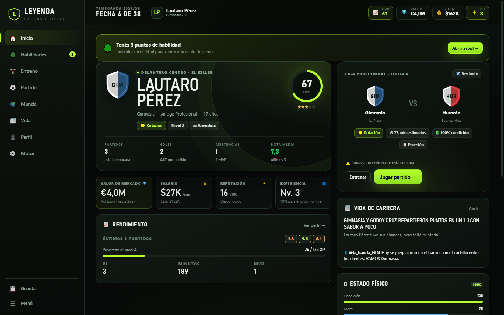
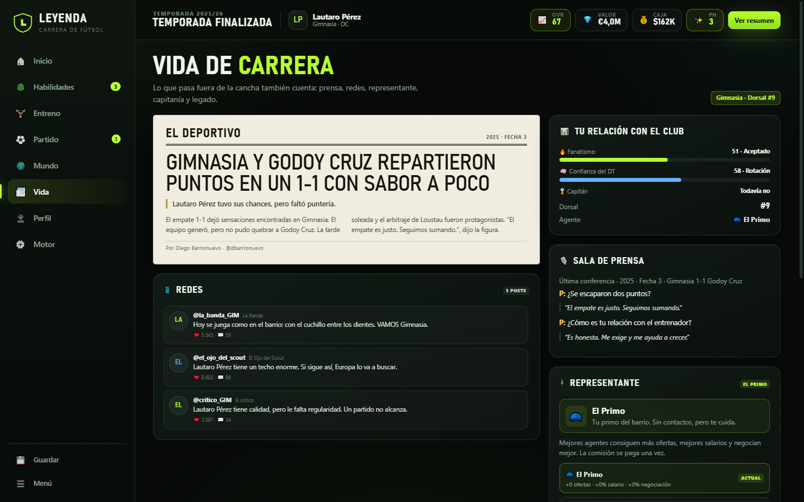

# LEYENDA
### Carrera de fútbol · del potrero al Balón de Oro

**LEYENDA** es un juego de carrera individual: creás un futbolista, entrenás semana a semana, construís un árbol de **78 habilidades** y jugás partidos donde cada ocasión se resuelve con tus atributos, tu estilo y el contexto. El mundo es el fútbol real: **6 ligas, 116 clubes**, mercado, selección, Copa del Mundo y Balón de Oro.

La **V2 · Vida de carrera** suma todo lo que pasa alrededor de la cancha: clima, árbitros, clásicos, tiempo agregado, VAR, charla técnica, conferencias de prensa, diarios, redes, representante, cláusulas de contrato, capitanía y legado en el club.

Hecho con HTML, CSS y JavaScript puro. Sin dependencias, sin build, sin servidor obligatorio.



---

## Jugarlo

### Opción A · doble clic (lo más simple)
Abrí `index.html` con Chrome, Edge o Firefox. El juego carga completo desde la carpeta y guarda la partida en el navegador.

### Opción B · servidor local opcional
Si tu navegador bloquea el guardado en `file://`, serví la carpeta:

```bash
cd leyenda
node servir.mjs
# LEYENDA · http://127.0.0.1:8124
```

También podés usar cualquier servidor estático que apunte a esta carpeta.

---

## La carrera en 30 segundos

1. **Creá tu jugador**: nombre, nacionalidad, posición (10), estilo (8 arquetipos) y dificultad.
2. **Elegí tu primer club** entre tres ofertas: más minutos o más vidriera.
3. **Cada semana**: elegí un foco de entrenamiento, su intensidad y jugá la fecha.
4. **Subí de nivel**, ganá puntos de habilidad y desbloqueá nodos del árbol.
5. **Al final de la temporada**: premios, copas, selección, ofertas y decisión de club.
6. **Repetí** hasta convertirte en leyenda, ganar el Balón de Oro y retirarte.

---

## Qué incluye

### Tu jugador
- **27 atributos** agrupados en físico, técnico, mental y defensa.
- **10 posiciones**: DFC, LD, LI, MCD, MC, MCO, ED, EI, DC y SD.
- **8 estilos**: El Pibe, El Killer, La Flecha, El Motor, El Muro, El Gladiador, El Artista y El Capitán.
- Edad, potencial, moral, condición, forma, reputación, valor de mercado, contrato y salario.
- Lesiones, sanciones, amarillas, expulsiones y declive físico después de los 30.

### Árbol de habilidades
- **78 nodos** en **6 ramas** (13 por rama): Pies de seda, Motor físico, Lectura de juego, Muro de acero, Instinto asesino y Ojo de halcón.
- Cada nodo cuesta puntos de habilidad (PH), pide nivel y prerrequisitos, y otorga atributos y/o **rasgos** que el motor usa en el partido.
- Los nodos de tier alto desbloquean rasgos como *Mago del balón*, *Candado*, *Killer*, *Ojo de halcón* o *Mentalidad de leyenda*.

### Entrenamiento y progresión
- 7 focos: físico, técnico, definición, creación, defensa, mental y recuperación.
- 3 intensidades con distinto costo de condición y riesgo de lesión.
- La ganancia depende del margen hasta el potencial, la edad, el foco, el staff y la dificultad.
- **Staff contratable**: preparador físico, nutricionista, psicólogo y entrenador personal (5 niveles cada uno).
- XP por entrenar y jugar, niveles, PH y desarrollo juvenil de pretemporada.

### El mundo
- **Premier League, LaLiga, Serie A, Bundesliga, Ligue 1 y Liga Profesional Argentina**.
- **116 clubes** con fuerza, prestigio, ciudad y colores; escudos generados.
- Tablas, goleadores, calendario de 34/38 fechas, forma reciente y simulación de todas las ligas.
- Copa nacional, Champions League / Europa League / Libertadores y selección.
- Copa del Mundo, Copa América y Eurocopa según el año.
- Mercado de invierno (fecha 19) y mercado de temporada con rol, salario, años y prima de fichaje.
- Premios: máximo goleador, MVP, mejor joven, equipo ideal y **Balón de Oro**.

### El partido
- Relato minuto a minuto con goles, atajadas, tarjetas, lesiones y cambios.
- **Jugadas decisivas interactivas**: hasta 4 por partido. Elegís tiro colocado, potencia, regate, pase, cabezazo, anticipar, aguantar o barrer.
- También podés **simular** el partido completo para avanzar rápido.
- Reporte final con nota, xG, posesión, remates, estadísticas, figura del partido y posición en la tabla.

### Vida de carrera (V2)
- **Pestaña Vida**: periódico, redes, prensa, representante, relación con el club y legado en un solo lugar.
- **Clima**: sol, nublado, lluvia, nieve, calor y viento. Cada uno cambia la precisión, los errores, la fatiga y las tarjetas. Se ve en la previa, en la cancha (partículas) y en el reporte.
- **Árbitros**: 10 perfiles con rigor propio (permisivo, equilibrado, estricto). Más rigor = más amarillas, más penales y más expulsiones.
- **Clásicos**: derbis reales (Superclásico, Avellaneda, Madrid, Milán, Manchester, etc.) con más intensidad, más tarjetas, más goles y un cambio enorme de fanatismo.
- **Tiempo agregado**: 90+1 a 90+5. El reloj llega hasta el descuento y ahí también se puede ganar o perder.
- **VAR**: 1 de cada 5 goles se revisa; 1 de cada 6 revisiones anula el gol. El relato se pausa, el estadio contiene la respiración y las estadísticas se corrigen.
- **Charla técnica**: en el entretiempo elegís tranquilidad, exigencia o motivación. Cambia la moral, la confianza del DT y las probabilidades del segundo tiempo.
- **Mapa de remates y momentum**: cada tiro tiene coordenadas; el reporte dibuja dónde se generó el peligro. El momentum muestra quién empuja.
- **Conferencias de prensa**: 2 preguntas después de cada partido, 3 respuestas posibles. Movés fanatismo, confianza del DT, reputación y moral. Lo que decís queda en el diario.
- **Periódico y redes**: tapa generada según el resultado, el clima, el árbitro, el clásico y tus declaraciones; posts de club, hinchas, prensa y rival.
- **Representante**: 3 tiers (El Primo, Representante de barrio, Superagente). Más ofertas, mejor salario y mejor negociación.
- **Cláusulas**: cláusula de rescisión, prima por gol, prima por partido y prima de fidelidad. Podés negociar cada oferta.
- **Fanatismo y confianza del DT**: la gente empuja de local; el DT decide tus minutos. Los dos se mueven con lo que hacés y con lo que decís.
- **Capitán, dorsal, récords y legado**: cinta cuando te ganás el vestuario, número de camiseta, récords de temporada y carrera, y un medidor de ídolo por club.



---

## El motor (cómo decide las jugadas)

No hay jugadas guionadas. Cada partido se genera con estas capas:

1. **Fuerza de los equipos**: fuerza del club + impacto de tu OVR + táctica + localía + moral + forma.
2. **Ocasiones**: `λ = 1,24 × (ataque/defensa)^2,45 × táctica × localía`; la cantidad de ocasiones se sortea con **Poisson**.
3. **xG**: cada ocasión recibe un valor entre 0,04 y 0,58 (media, clara o mano a mano).
4. **Participación**: posición, estilo, minutos y tu peso frente al plantel definen si la jugada es tuya, de un compañero o del rival.
5. **Resolución**: `xG × (0,55 + (atributo − 45)/95) × rasgos × estilo`. El arquero/rival y la táctica ajustan el resto.
6. **Nota**: base 6,25 + goles, asistencias, pases clave, duelos, regates, errores y resultado.
7. **Contexto V2**: clima (precisión, fatiga y tarjetas), árbitro (rigor), clásico (intensidad), charla técnica (1,00 / 1,08 / 1,05), fanatismo (±3% de ataque) y confianza del DT (±3 minutos).
8. **VAR y agregado**: 1-5 minutos de descuento; 20% de los goles se revisan y 16% de esas revisiones los anulan. Si el VAR anula un gol, se corrigen el marcador y las estadísticas del jugador.

El estilo multiplica tu participación: un Killer tiene más peso como finalizador; un Pibe, como creador; un Muro, en el duelo defensivo. La pestaña **Motor** del juego muestra tus porcentajes y probabilidades actuales con las mismas funciones que usa el partido.

### Rasgos que cambian el motor
Los rasgos no son cosméticos: modifican probabilidades reales. Por ejemplo:
- *Imprevisible*: +6% en el 1v1.
- *Incansable*: −20% de fatiga.
- *Candado*: −10% al xG rival.
- *Killer*: +12% de conversión en el área.
- *Ojo de halcón*: +15% en pases filtrados.
- *Frío como el hielo*: +12% en los últimos 15 minutos.

---

## Controles

- **Mouse/touch**: todo se juega con clics o toques.
- **Partido en vivo**: velocidad 1x / 2x / 4x, pausa y salto al final.
- **Jugada decisiva**: elegí una de las opciones; el motor resuelve con tus atributos y te muestra el resultado.
- **Charla técnica**: en el entretiempo elegí tranquilidad, exigencia o motivación.
- **VAR**: esperá la revisión; el gol puede confirmarse o anularse.
- **Conferencia**: una respuesta por pregunta; después ves el titular y los efectos.
- **Guardado**: automático en cada acción importante; también manual desde el menú.
- **Exportar/Importar**: código de texto para llevarte la carrera a otro dispositivo.

---

## Guardado y datos

- Guardado local en `localStorage`, clave `leyenda_save_v1`.
- También podés exportar la carrera como código desde **Menú → Exportar** e importarla en otro navegador.
- La partida se guarda después de entrenar, jugar, fichar y avanzar de semana.
- Si recargás justo después de un partido, el dashboard te ofrece **Continuar semana** para no duplicar estadísticas.
- Si recargás con una conferencia pendiente, la pestaña **Vida** y el dashboard te la recuerdan; podés responderla o mandar un vocero.

---

## Estructura del proyecto

```
leyenda/
├── index.html              # shell del juego
├── css/
│   └── estilo.css          # sistema visual completo (desktop + mobile)
├── js/
│   ├── datos.js            # atributos, posiciones, estilos, 78 skills, 116 clubes
│   ├── vida-datos.js       # climas, árbitros, clásicos, agentes, prensa, diarios y redes
│   ├── motor.js            # mundo, fixtures, tablas, entrenamiento, mercado, premios
│   ├── partido.js          # motor de partido por ocasiones y decisiones
│   ├── vida.js             # prensa, medios, récords, capitanía y legado
│   ├── juego.js            # estado, carrera, XP, guardado, temporadas
│   ├── ui.js               # inicio, creación, dashboard, árbol, entreno, mundo
│   ├── ui-partido.js       # previa, partido en vivo, reporte, resumen de temporada
│   ├── ui-perfil.js        # perfil, palmarés, legado y pestaña Motor
│   └── ui-vida.js          # pestaña Vida, periódico, redes, agente y conferencia
├── servir.mjs              # servidor estático opcional (sin dependencias)
├── docs/                   # capturas
└── test/                   # pruebas de desarrollo (Node, sin dependencias)
```

### Pruebas de desarrollo
Desde `leyenda/`:

```bash
node test/carrera-test.cjs    # 6 temporadas completas, progresión, premios y mercado
node test/momentos-test.cjs   # partidos interactivos, goles, VAR y guardado
node test/v2-test.cjs         # clima, árbitro, clásico, agregado, prensa, agente y cláusulas
```

Las pruebas corren el motor real en Node. El juego se validó además en Chrome headless a 1440×900 y 390×844, con capturas de todas las pantallas.

---

## Notas técnicas

- **Sin dependencias**: no hay frameworks, ni build, ni paquetes. Todo es HTML/CSS/JS clásico.
- **Sin recursos externos**: no carga fuentes, imágenes ni APIs. Funciona offline.
- **Responsive**: sidebar en desktop, barra inferior en mobile; árbol con scroll horizontal.
- **Compatibilidad**: Chrome/Edge/Firefox/Safari modernos. Usa `color-mix` y `dvh`; en navegadores viejos algunos brillos pueden no verse, pero el juego funciona.
- **Datos**: las fuerzas y prestigios son aproximaciones del fútbol 2025/26. Los escudos son generados (iniciales + colores), no oficiales.

---

## Créditos

Proyecto fan-made, gratuito y no comercial. Los nombres de clubes, ligas y selecciones se usan como referencia del mundo real; los escudos y datos deportivos son ficticios/aproximados. Hecho para la comunidad futbolera.

**LEYENDA v2.0** · Del potrero al mundo. Y todo lo que pasa alrededor.
